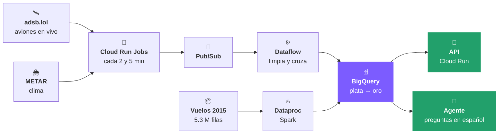
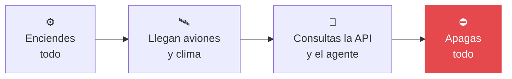

<h1 align="center">🦅 Águila</h1>

<p align="center">
  <b>La plataforma de datos de AeroNexus Continental.</b><br>
  Aviones en vivo, clima de aeropuertos y 5.3 millones de vuelos históricos, listos para responder preguntas del negocio.
</p>

<p align="center">
  ☁️ Google Cloud &nbsp;·&nbsp; 🥉🥈🥇 Bronce, plata y oro &nbsp;·&nbsp; ⚡ Tiempo real y por lotes &nbsp;·&nbsp; 🎓 UTEC Big Data, Grupo 4
</p>

---

## 🎬 ¿Qué hace, en una imagen?



Dos caminos llegan al mismo lugar: el **tiempo real** (aviones y clima de hoy) y el **histórico** (puntualidad de 2015).
Todo termina en la capa **oro** de BigQuery, que se consulta con la API o conversando con el agente.
Todo corre en Google Cloud y se levanta con Terraform: no depende de ninguna PC.

---

## 🧰 Las piezas

|     | Carpeta | Para qué sirve |
| :-: | :------ | :------------- |
| 🏗️ | **`infra/`** | Terraform: APIs, bucket, datasets, Pub/Sub, secreto, cuentas de servicio con permisos por recurso, jobs, schedulers, API y gobierno. |
| 🛰️ | **`ingesta/`** | Contenedor que corre como Cloud Run Job: pide aviones a adsb.lol (o a OpenSky) y clima a METAR, los guarda en bronce y los envía a Pub/Sub. Reintenta si la fuente falla. |
| ⚙️ | **`streaming/`** | Pipeline de Dataflow (Apache Beam): limpia cada avión, le pone el aeropuerto más cercano y lo guarda en BigQuery. `operar.py` lo enciende y apaga sin mensajes acumulados. |
| 🔥 | **`batch/`** | Spark limpia los vuelos de 2015; también reprocesa todo (`backfill.py`) o vuelve a publicar días pasados (`republicar.py`). |
| 🗄️ | **`sql/`** | Construye plata y oro: modelo estrella, puntualidad por ruta y aerolínea, clima actual y latencia. `ml.sql` entrena con BigQuery ML el modelo que predice el riesgo de retraso de cada vuelo. |
| 🔌 | **`api/`** | API en Cloud Run que entrega aviones, clima y puntualidad en JSON. |
| 🏷️ | **`gobierno/`** | Gobierno como código: plantilla de Knowledge Catalog y los valores de cada tabla. |

Opcional: un colector de OpenSky para PC, con panel, en [radar-colector](https://github.com/gcquirozguzman/radar-colector). La plataforma no lo necesita.

---

## 🔌 La API

Vive en Cloud Run y es privada: solo responde a quien tiene acceso al proyecto.

| Pregunta del negocio | Endpoint |
| :------------------- | :------- |
| ¿Cómo está hoy un aeropuerto? | `GET /aeropuertos/ATL/panorama` |
| ¿Qué aviones hay cerca? | `GET /aeropuertos/DFW/aviones?radio_km=30` |
| ¿Qué clima tiene ahora? | `GET /aeropuertos/ORD/clima` |
| ¿Qué tan puntual es una ruta? | `GET /rutas/LAX/SFO/otp` |
| ¿Qué tan puntual es una aerolínea, mes a mes? | `GET /aerolineas/AA/otp` |

### Probarla en el navegador

```
gcloud run services proxy aguila-api --region us-central1 --project aguila-aeronexus
```

Abre http://localhost:8080/docs y prueba cada endpoint con el botón **Try it out**.

### Probarla desde la terminal

```
curl -H "Authorization: Bearer $(gcloud auth print-identity-token)" https://aguila-api-305567386804.us-central1.run.app/rutas/LAX/SFO/otp
```

> 🟢 Responde `{"origen_id":"LAX","destino_id":"SFO","vuelos":13457,"otp_pct":72.9,...}` → todo bien.
> 🔴 Responde `403` → falta el token o tu cuenta no tiene acceso al proyecto.

---

## 💬 El agente

En BigQuery → **Agentes** está **Águila Analista**. Se le pregunta en español, por ejemplo:

- *¿Cuáles son las 5 rutas con peor puntualidad?*
- *¿Qué aeropuertos tienen hoy condición adversa?*
- *¿Cuántos aviones hay ahora cerca de Atlanta?*

Lee solo la capa oro y muestra la consulta SQL que usó para responder.

✨ También está registrado en **Gemini Enterprise** (app `aguila-aeronexus`) para usarlo desde el chat de la empresa:
en BigQuery se publica con **Registrar este agente** y **Copiar JSON**, y en Gemini Enterprise → **Agentes → Agregar agente → A2A** se pega ese JSON.

---

## 🚀 Primera vez (solo una vez)

### 1️⃣ Ten Python 3.12 y gcloud

`py -3.12 --version` y `gcloud --version` deben responder con un número.

### 2️⃣ Inicia sesión en Google Cloud

```
gcloud auth login
gcloud auth application-default login
gcloud config set project aguila-aeronexus
```

### 3️⃣ Instala las librerías

<details open>
<summary><b>🪟 Windows</b></summary>

```
py -3.12 -m venv .venv
.venv\Scripts\python -m pip install "apache-beam[gcp]==2.61.0" -r ingesta/requirements.txt -r api/requirements.txt
```

</details>

<details>
<summary><b>🍎 Mac / 🐧 Linux</b></summary>

```
python3.12 -m venv .venv
.venv/bin/python -m pip install "apache-beam[gcp]==2.61.0" -r ingesta/requirements.txt -r api/requirements.txt
```

</details>

### 4️⃣ Levanta la infraestructura con Terraform

```
cd infra
terraform init
terraform apply
```

Crea (o adopta, si ya existen) las APIs, el bucket, los datasets, Pub/Sub, el secreto, las cuentas de servicio con sus permisos, los jobs de ingesta, los schedulers, la API y la plantilla de gobierno. En un proyecto nuevo borra antes `infra/imports.tf`. `terraform apply -var ingesta_activa=true` reanuda la ingesta; `false` la pausa.

---

## 🎯 La demo, paso a paso



**1. Enciende el tiempo real** (unos 5 minutos antes; Dataflow tarda en arrancar):

```
.venv\Scripts\python streaming/operar.py encender
```

Descarta lo que se acumuló en Pub/Sub mientras estuvo apagado (ya está guardado en bronce), lanza Dataflow con autoescalado de 1 a 2 workers y reanuda los jobs de ingesta.

**2. Mira llegar los datos:** cada 2 minutos el job `aguila-ingesta-opensky` publica miles de aviones de adsb.lol; se ve en Cloud Run → Jobs → Registros.

**3. Muestra el resultado:** la API (`/aeropuertos/ATL/panorama`) y el agente.

**4. Apaga todo al terminar.** ⚠️ Dataflow encendido cuesta unos S/ 15 a S/ 20 al día.

```
.venv\Scripts\python streaming/operar.py apagar
```

💡 **Tip:** para practicar sin gastar, corre el pipeline en tu PC con `--runner DirectRunner --temp_location gs://aguila-aeronexus-bronce/tmp`.

---

## 🗄️ Lo que hay en BigQuery

| Capa | Qué guarda |
| :--- | :--------- |
| 🥉 **bronce** (Cloud Storage) | Los archivos tal como llegan: CSV de vuelos, OpenFlights, METAR y cada consulta de aviones (`grabaciones/`). |
| 🥈 **plata** | Vuelos 2015 limpios (`vuelos`), los inválidos (`vuelos_cuarentena`), clima diario NOAA y lo que llega en vivo (`posiciones`, `metar`). |
| 🥇 **oro** | Modelo estrella (`fact_vuelos`, `fact_posiciones`, `dim_*`) y vistas para el negocio: `otp_por_ruta`, `otp_por_aerolinea`, `causas_retraso`, `clima_actual`, `sli_latencia`. |

<details>
<summary><b>🔥 Cargar el histórico (lotes)</b></summary>

```
gcloud storage cp batch/limpiar_vuelos.py gs://aguila-aeronexus-bronce/codigo/
gcloud dataproc batches submit pyspark gs://aguila-aeronexus-bronce/codigo/limpiar_vuelos.py --region=us-central1 --version=2.2 --service-account=sa-dataproc@aguila-aeronexus.iam.gserviceaccount.com --staging-bucket=aguila-aeronexus-bronce -- gs://aguila-aeronexus-bronce/flight_delays/2015/flights.csv gs://aguila-aeronexus-bronce/plata
```

Después se ejecutan `sql/plata.sql` y `sql/oro.sql` en BigQuery. Para rehacer todo de una vez: `python batch/backfill.py`.

</details>

<details>
<summary><b>🔌 Desplegar la API</b></summary>

```
gcloud run deploy aguila-api --source api --region us-central1 --service-account sa-api@aguila-aeronexus.iam.gserviceaccount.com --no-allow-unauthenticated --max-instances 2
```

</details>

<details>
<summary><b>🐳 Desplegar la ingesta</b></summary>

```
gcloud run jobs deploy aguila-ingesta-opensky --source ingesta --region us-central1
```

El job `aguila-ingesta-metar` usa la misma imagen. Su configuración (variables, cuenta, secreto) la fija Terraform.

</details>

---

## 🛡️ Calidad y seguridad

| | Qué pasa | Cómo lo resolvemos |
| :-: | :------- | :----------------- |
| 🔁 | La fuente de aviones o METAR fallan | Reintenta 4 veces (2, 4 y 8 s) y respeta `Retry-After`; si sigue fallando, reproduce la última grabación real. |
| 🚫 | Llega un dato roto | Dataflow lo manda al tópico `errores` y sigue con el resto. |
| ♻️ | Hay que reprocesar | En los últimos 7 días: `gcloud pubsub subscriptions seek posiciones-sub --time=<fecha>`. Antes: `python batch/republicar.py --desde <fecha> --hasta <fecha>`. |
| 👯 | Llegan duplicados | `oro.fact_posiciones` deja una sola fila por avión y consulta. |
| ⏱️ | ¿Llega a tiempo? | `oro.sli_latencia` mide cada consulta. Meta: menos de 3 minutos. |
| 🔑 | Credenciales | La de OpenSky vive en Secret Manager. Cada pieza usa su propia cuenta y cada permiso es sobre el recurso exacto (`infra/iam.tf`): `sa-ingesta` solo ejecuta sus 2 jobs y escribe en sus carpetas del bucket; `sa-api` solo lee oro. |
| 🏷️ | ¿De quién es cada tabla? | En Knowledge Catalog, la plantilla **Gobierno Águila** dice capa, dueño, custodio, clasificación, calidad y retención de las 20 tablas y vistas. Se aplica con `python gobierno/etiquetar.py`. |

Pruebas de los reintentos: `python -m unittest ingesta/test_reintentos.py`.

---

## 📚 Fuentes

adsb.lol (ODbL) · OpenSky Network · aviationweather.gov (METAR) · Flight Delays 2015 (BTS/Kaggle) · NOAA GSOD · OpenFlights

> OpenSky bloquea las IP de los grandes proveedores de nube, así que en la nube los aviones vienen de adsb.lol, una red
> abierta de receptores ADS-B. El job prueba las fuentes en orden (`AVIONES_FUENTES=adsblol,opensky`) y, si ninguna
> responde, reproduce la última grabación real y la marca como `modo=reproduccion`.

## 📄 Licencia

MIT
